# وثيقة الخطة المعمارية الشاملة والنهائية: النظام المالي والمحاسبي المتكامل
## مبني وفق النظام المحاسبي الموحد العراقي المحدث ومعايير الإبلاغ المالي الدولية (IFRS)
### الإصدار: 1.0 (معتمد للتنفيذ والمناقشة المهنية) | تاريخ الصياغة: 23 تشرين الثاني 2026

---

## 1. الرؤية العامة والأهداف الاستراتيجية (Executive Vision)

يهدف هذا المشروع إلى بناء **نواة محاسبية قياسية متقدمة (Core Enterprise Accounting Engine)** تلبي متطلبات:
1. **العمليات التشغيلية لمستشفى متكامل:** ربط لحظي ذكي مع الكاشير، العمليات الجراحية، الرقود، المختبر، الأشعة، الصيدلية، المخازن، وحصص الأطباء والضمان الصحي.
2. **الاستقلالية وقابلية الفصل التجاري (Decoupled Commercial Product):** معمارية معزولة تتيح استخراج الموديول المحاسبي وبيعه كمنتج مستقل لأي شركة تجارية، صناعية، أو خدمية، مع دعم التشغيل كـ **منصة سحابية متعددة الشركات (Multi-Tenant SaaS)** أو **نسخة محلية خاصة (On-Premise)**.
3. **الامتثال التام للتشريعات العراقية والدولية:** تطبيق الدليل المحاسبي للنظام المحاسبي الموحد العراقي المحدث والمتوافق مع معايير IFRS/IAS وقواعد الرقابة والتدقيق لديوان الرقابة المالية الاتحادي.

---

## 2. الهيكلية المعمارية البرمجية (System Architecture)

تم اعتماد معمارية **(Decoupled Modular Architecture with Pluggable Adapters)**:

```
┌─────────────────────────────────────────────────────────────────────────────┐
│                    محرك المحاسبة المركزي المستقل                            │
│                 (Core Accounting Engine - Module)                           │
│   [acc_accounts, acc_journal_entries, acc_vouchers, acc_cost_centers]       │
└──────────────────────────────────────┬──────────────────────────────────────┘
                                       │
        ┌──────────────────────────────┴──────────────────────────────┐
        ▼                                                             ▼
┌──────────────────────────────┐              ┌──────────────────────────────┐
│  محول المستشفى الداخلي       │              │  محول الشركات التجاري المستقل│
│      (Hospital Adapter)      │              │     (Commercial Adapter)     │
├──────────────────────────────┤              ├──────────────────────────────┤
│ • ربط الكاشير والوصولات      │              │ • فواتير مبيعات ومشتريات عامة│
│ • تسوية استهلاك العمليات     │              │ • نظام رواتب عام للموظفين    │
│ • مطالبات هيئة الضمان الصحي  │              │ • مراكز تكلفة للمشاريع والفروع│
│ • أمانات وحصص الأطباء        │              │ • إدارة المخازن العامة       │
│ • عهد مخازن الطوابق          │              │ • بوابات دفع وسداد إلكتروني  │
└──────────────────────────────┘              └──────────────────────────────┘
```

### معايير العزل البرمجي:
- **قاعدة البيانات:** جميع الجداول تبدأ ببادئة مستقلة `acc_`، ولا ترتبط بأي مفتاح أجنبي صلب (Foreign Key) مع جداول المستشفى، بل عبر علاقات مرجعية متعددة الأشكال (`Polymorphic: source_type & source_id`).
- **مسارات الكود المنفصلة:**
  - النماذج: `app/Models/Accounting/`
  - المتحكمات: `app/Http/Controllers/Accounting/`
  - الخدمات المحاسبية: `app/Services/Accounting/`
  - الواجهات: `resources/views/accounting/`
- **حقل تعدد الشركات (`company_id`):** موجود في كافة الجداول المحاسبية لتمكين تشغيل ميزة الـ SaaS مستقبلاً عبر `Global Scope` دون تعديل الكود.

---

## 3. الدليل المحاسبي وشجرة الحسابات (Chart of Accounts)

### أ. التبويب الرباعي الرئيسي
- **`1` الأصول (Assets):** أصول غير متداولة (`11`)، إنفاق رأسمالي (`12`)، أصول متداولة مخزون وذمم ونقدية (`13`)، أصول أخرى (`14`)، أصول غير ملموسة (`15`).
- **`2` الالتزامات وحقوق الملكية (Liabilities & Equity):** التزامات غير متداولة (`21`)، متراكم الاندثار والديون المشكوك فيها (`22`)، التزامات متداولة وذمم دائنة (`23`)، مخصصات (`25`)، حقوق الملكية ورأس المال (`26`).
- **`3` الاستخدامات / المصروفات (Expenses):** رواتب وأجور ومخصصات مهنية (`31`)، مستلزمات سلعية وأدوية (`32`)، مستلزمات خدمية وصيانة أجهزة ومباني صحية (`33`)، اندثارات وإطفاءات (`37`)، مصروفات تحويلية وخسائر (`38`).
- **`4` الموارد / الإيرادات (Revenues):** إيراد النشاط الخدمي للخدمات الصحية (`4312`) وتفريعاته (`43121` كشفية، عمليات، مختبر، أشعة، رقود، طوارئ، حضانات)، إيرادات النشاط التجاري والتشغيلي (`42`/`44`)، إيرادات تحويلية ومكاسب (`48`/`49`).

### ب. قاعدة التقييد الصارمة على المستويين 5 و 6 (Level 5 & 6 Posting Rule)
- **المستويات 1 إلى 4 (مستويات تجميعية ورقابية Header Only):**
  - المستوى 1 (الأب الأول: مثل `1 الأصول`).
  - المستوى 2 (الحساب العام: مثل `13 الأصول المتداولة`).
  - المستوى 3 (الحساب المساعد: مثل `134 النقود`).
  - المستوى 4 (الحساب الفرعي: مثل `1341 نقدية بالصندوق`).
  - **قاعدة صارمة:** يُحظر حظراً تاماً تسجيل أو ترحيل أي قيد يومية على المستويات 1 إلى 4؛ هذه حسابات تجميعية لعرض الإجماليات وموازين المراجعة فقط.
- **المستوى 5 (الابن الخامس - Posting Account Level 5):**
  - يتم فتح حساب من 5 خانات (مثل `13411 نقدية لدى صندوق المركز`).
  - إذا لم يكن لهذا الحساب أبناء (سادس)، يُقبل التقييد المباشر عليه كحساب نهائي.
- **المستوى 6 (الابن السادس - Posting Account Level 6):**
  - عند الحاجة للتفصيل والتحليل الدقيق، يُفرّع من المستوى الخامس حساب سداسي (مثل `134111 نقدية لدى صندوق المركز بالعملة المحلية`).
  - يرتبط المستوى السادس بالخامس، والخامس بالرابع وهكذا وصولاً للأب الأول.
  - عند وجود المستوى السادس، يُقفل التقييد على الخامس ويتحول التقييد المالي الفعلي حصراً إلى **المستوى السادس**.

---

## 4. محرك العملات وسعر الصرف الرسمي (Currency & Exchange Rate Engine)

1. **العملة الأساسية (Base Operating Currency):** الدينار العراقي (IQD).
2. **سعر الصرف الرسمي للدولار (USD Official Rate):**
   - اعتماد سعر الصرف الرسمي المعتمد في العراق (مثلاً 1320 دينار لكل دولار أو ما يحدده البنك المركزي).
   - توفير شاشة إعدادات مالية تتيح لمدير النظام تثبيت سعر الصرف أو تعديله وتحديثه لحظياً في حال صدور أي تغيير رسمي.
   - حفظ تاريخ التغيير لضمان أن العمليات السابقة تحتفظ بسعر الصرف الذي نُفذت به دون تأثر بتغييرات المستقبل.
   - دعم تسجيل المبالغ بالدولار في السندات مع احتساب المقابل بالدينار العراقي آلياً وتثبيته في القيد المزدوج.

---

## 4. شجرة مراكز التكلفة (Cost Centers Tree)

تم تصميم شجرة مراكز التكلفة لتطابق الواقع الميداني للمستشفى مع إمكانية تخصيصها لأي نشاط تجاري:

```mermaid
flowchart TD
    CC["شجرة مراكز التكلفة"]
    
    CC --> C1["1. مراكز الإنتاج والإيراد الطبي"]
    CC --> C2["2. مراكز الخدمات التشخيصية والمساعدة"]
    CC --> C3["3. مراكز المخازن والإمداد الدوائي"]
    CC --> C4["4. مراكز الخدمات الفندقية والصيانة"]
    CC --> C5["5. مراكز الإدارة العامة والخدمات المشتركة"]

    C1 --> C11["1.1 صالات العمليات والجراحة والولادة"]
    C1 --> C12["1.2 ردهات الرقود والإقامة (طابق 2، 4، 5)"]
    C1 --> C13["1.3 قسم الخدج والحاضنات (NICU)"]
    C1 --> C14["1.4 قسم الطوارئ والحوادث"]
    C1 --> C15["1.5 العيادات الاستشارية (باطنية، جراحة، عيون، أطفال، أسنان...)"]

    C2 --> C21["2.1 المختبر الطبي ومصرف الدم"]
    C2 --> C22["2.2 قسم الأشعة والسونار والرنين"]

    C3 --> C31["3.1 المخزن الرئيسي"]
    C3 --> C32["3.2 صيدلية المستشفى ومخازن الأجنحة"]

    C4 --> C41["4.1 الفندقة والضيافة ونظافة الردهات"]
    C4 --> C42["4.2 الصيانة والأجهزة الطبية والمولدات"]
    C4 --> C43["4.3 الاستقبال ورسبشن الضمان"]

    C5 --> C51["5.1 الإدارة العامة والموارد البشرية"]
    C5 --> C52["5.2 قسم الحسابات والمالية"]
    C5 --> C53["5.3 الإحصاء وتقنية المعلومات IT"]
```



---

## 5. الدورة المستندية ونظام السندات (Vouchers System)

يتعامل المحاسب مع واجهات سندات مبسطة وتلقائية، بينما يولد المحرك القيود المزدوجة المتوازنة في الخلفية:

1. **سند القبض (Receipt Voucher - RV):**
   - يُثبت استلام النقدية أو الشيكات أو التحويلات المصرفية.
   - القيد: `من حـ/ الصندوق أو المصرف (1341/1342) ⬅️ إلى حـ/ العميل أو المدين أو الإيراد`.
2. **سند الصرف (Payment Voucher - PV):**
   - يُثبت صرف المبالغ النقدية للمصاريف، الموردين، أو حصص الأطباء.
   - القيد: `من حـ/ المصروف أو المورد أو الطبيب ⬅️ إلى حـ/ الصندوق أو المصرف`.
3. **قيد اليومية العام والتسويات (Journal Voucher - JV):**
   - لإدخال التسويات اليدوية، قيود الاندثار، قيود الرواتب، وتسويات نهاية العام.
4. **إشعارات التسوية المدينة والدائنة (Debit & Credit Notes):**
   - لمعالجة فروقات ومرفوضات الضمان الصحي والخصومات المعتمدة.

---

## 6. قواعد الرقابة الصارمة وسجل التدقيق (Audit Trail & Security)

1. **مبدأ عدم القابلية للحذف (Immutability):**
   - القيد بعد الترحيل (`status = 'posted'`) يُقفل نهائياً ويُمنع حذفه أو تعديل أرقامه للمستخدمين والمحاسبين.
   - الطريقة القياسية المعتمدة للتصحيح هي **(قيد العكس الرقابي - Reversal Entry)** بإنشاء قيد آلي متوازن يعكس الأطراف ويوثق رقم القيد الأصلي المرجعي.
2. **الصلاحية الاستثنائية للمدير العام (Super Admin Emergency Override):**
   - يُمنح المدير العام فقط صلاحية طارئة ومحمية لتعديل أو إلغاء ترحيل قيد.
   - يُشترط تسجيل العملية في **سجل التدقيق الرقابي (`acc_audit_logs`)** ويوثق: (معرف المستخدم، القيمة السابقة، القيمة المعدلة، سبب التعديل الإلزامي، والبصمة الزمنية وعنوان IP).

---

## 7. المعالجات المحاسبية الخاصة بالمستشفى (Hospital Workflows)

### أ. محرك توليد القيود التلقائي والترحيل المباشر للصندوق (Automated Real-Time Posting)
- بمجرد قيام الكاشير بتأكيد قبض أي وصل (استشارية، مختبر، أشعة، طوارئ، أو عمليات)، يقوم النظام بـ:
  1. إنشاء قيد يومية آلي فوري يرحل مباشرة إلى **حساب الصندوق (`134111` أو `134121` - المستوى 6)** دون الحاجة إلى تدخل يدوي.
  2. توثيق رقم الوصل، معرف المريض (`patient_id`)، واسم المريض، ورقم الملف الطبي في حقول البيان والمرجع (`reference_id` / `description`).

### ب. تفصيل قيد المريض الواحد وتفكيك بنود الخدمات إلى الأقسام (Multi-Department Granularity)
عندما يسدد المريض وصلاً يحتوي على عدة خدمات متزامنة (مثلاً: استشارة طبيب + تحليل دم + صورة أشعة + خدمات طوارئ):
- **لا يسجل القيد كإيراد عام مجمع**، بل يُفكك في نفس القيد إلى أسطر دائنة تفصيلية موزعة على الحسابات ومراكز التكلفة:

#### 1. حالة المريض النقدي (Full Cash):
- **الطرف المدين:**
  - `مدين`: حـ/ نقدية لدى صندوق الكاشير (`134121` - المستوى 6) [كامل المبلغ المقبوض].
- **الأطراف الدائنة (موزعة بدقة):**
  - `دائن`: حـ/ إيراد خدمات الاستشارية (`431211` - المستوى 6) [حصة المستشفى] - مركز تكلفة: العيادة الاستشارية المعنية.
  - `دائن`: حـ/ أمانات ومستحقات الطبيب الاستشاري (`232641` - المستوى 6) [كشفية الطبيب 100% أو حسب نسبته].
  - `دائن`: حـ/ إيراد خدمات التحاليل الطبية (`431212` - المستوى 6) - مركز تكلفة: المختبر.
  - `دائن`: حـ/ إيراد خدمات الفحص بالأشعة والسونار (`431213` - المستوى 6) - مركز تكلفة: قسم الأشعة.
  - `دائن`: حـ/ إيراد خدمات الطوارئ والعناية (`431214` - المستوى 6) - مركز تكلفة: قسم الطوارئ.

#### 2. حالة مريض هيئة الضمان الصحي (Health Insurance / MOI Police):
- **الأطراف المدينة (مقسمة بين المريض والهيئة):**
  - `مدين`: حـ/ نقدية لدى صندوق الكاشير (`134121` - المستوى 6) [نسبة التحمل النقدية المسددة في القاصة مثلاً 10% أو 15,000 د.ع].
  - `مدين`: حـ/ مدينو قطاع عام - هيئة الضمان الصحي (`132111` - المستوى 6) [باقي قيمة الفاتورة المطلوب تحصيلها من هيئة الضمان].
- **الأطراف الدائنة:**
  - `دائن`: إيرادات الخدمات الصحية حسب كل قسم ومراكز التكلفة المذكورة أعلاه (بحصة المستشفى المعتمدة بعقد الضمان).
  - `دائن`: حـ/ أمانات ومستحقات الأطباء (`232641` - المستوى 6) [بحصة الطبيب المحددة في جدول الضمان].

### ج. العمليات الجراحية والاستهلاك المخزني السريري (Surgeries & Inventory Consumption)
- **قيد توزيع إيراد وأتعاب العملية الجراحية:**
  - `مدين`: حـ/ الصندوق أو مدينو الضمان.
  - `دائن`: حـ/ أمانات الجراح الرئيسي (`232641`).
  - `دائن`: حـ/ أمانات مساعد الجراح (`232642`).
  - `دائن`: حـ/ أمانات طبيب التخدير (`232643`).
  - `دائن`: حـ/ إيراد صالات العمليات والإقامة الجراحية (`431215`) [مركز تكلفة: صالة العمليات].
- **قيد الاستهلاك السريري للمواد والأدوية (يولد تلقائياً عند تسجيل الممرض أو الجراح استهلاك المواد أثناء العملية):**
  - `مدين`: حـ/ مواد ومستلزمات طبية مستهلكة (`32631` - المستوى 6) [مركز تكلفة: صالة العمليات المعنية].
  - `دائن`: حـ/ مخزون الأدوية والمستلزمات الطبية (`131111` - المستوى 6) [يُخصم من رصيد وجبات مخزن العمليات].

### د. تسوية مطالبات الضمان الصحي ومعالجة المرفوضات (Claims & Rejections)
- عند تحصيل دفعة الضمان عبر صك أو تحويل مصرفي:
  - `مدين`: حـ/ نقدية لدى المصارف (`134211` - المستوى 6) [بالمبلغ الصافي المستلم].
  - `دائن`: حـ/ مدينو قطاع عام - هيئة الضمان (`132111` - المستوى 6) [بقيمة المطالبة المغلقة].
- **معالجة المرفوضات (بناءً على اختيار المحاسب):**
  - خيار (1): تحميل المستشفى ⬅️ `مدين: حـ/ مسموحات وخصومات تسوية الضمان (3828)`.
  - خيار (2): تحميل الطبيب ⬅️ `مدين: حـ/ أمانات ومستحقات الأطباء (232641)`.
  - خيار (3): تقاسم نسبي تعاقدي بين الطرفين.

### هـ. تسليم الشفتات وتوريد القاصة (Cash Drawer Handover & Drop)
- عند نهاية شفت الكاشير:
  - يورد الكاشير النقدية للخزينة المركزية عبر سند تحويل داخلي:  
    `من حـ/ صندوق المركز الرئيسي (134111) ⬅️ إلى حـ/ صندوق الكاشير الفرعي (134121)`.
- معالجة الفروقات:
  - العجز: يُسجل كـ `سلفة عجز نقدية على الكاشير (1326811)`.
  - الزيادة: تُسجل كـ `أمانات فروقات نقدية دائنة (232681)`.

---

## 8. الأصول الثابتة والاندثارات الآلية (Fixed Assets & Depreciation)

- **سجل الأصول (`acc_fixed_assets`):** يوثق كود الأصل، اسمه، تاريخ الشراء، كلفة الاقتناء، العمر الإنتاجي، ومعدل الإهلاك السنوي، ومركز التكلفة التابع له.
- **محرك الإهلاك التلقائي بنقرة زر:**
  - يقوم النظام باحتساب القسط الشهري تلقائياً:  
    `من حـ/ مصروف اندثار الآلات والمعدات الطبية (37113) [مركز تكلفة القسم] ⬅️ إلى حـ/ متراكم اندثار الآلات والمعدات (2213)`.

---

## 9. الفترات والسنوات المالية وإقفال الحسابات (Fiscal Closing)

1. **إقفال الشهور (Monthly Period Locking):**
   - تجميد الشهر المالي المنتهي ومنع إضافة أو تعديل أو إلغاء أي قيد أو وصل سابق لتاريخ الإقفال، لضمان تطابق الأرقام مع التقارير الصادرة.
2. **الإقفال السنوي وتدوير الأرصدة (Year-End Closing):**
   - تصفير حسابات الاستخدامات (3) والموارد (4) وترحيل الصافي إلى حساب `النشاط الجاري (2691)` ومن ثم إلى `الفائض/العجز المتراكم (2631/2632)`.
   - نقل أرصدة الأصول والالتزامات آلياً كـ **أرصدة افتتاحية (Opening Balances)** للسنة المالية الجديدة.

---

## 10. التقارير المالية وميزان المراجعة (Reporting Engine)

- **ميزان المراجعة التفاعلي (Trial Balance):** بالمجاميع وبالأرصدة، مع إمكانية الفلترة اللحظية حسب المستوى من 1 (كلي) إلى 6 (تحليلي تفصيلي)، والفلترة بمراكز التكلفة.
- **دفتر الأستاذ العام (General Ledger):** كشف حركة تفصيلي لأي حساب خلال فترة زمنية مع الرصيد التراكمي اللحظي وروابط مباشرة للسندات.
- **قائمة الدخل / الأرباح والخسائر (Income Statement):** إجمالي الإيرادات ناقص إجمالي المصروفات لبيان صافي الربح أو الفائض المالي.
- **قائمة المركز المالي / الميزانية العمومية (Balance Sheet):** الأصول مقابل الالتزامات وحقوق الملكية.
- **كشف ربحية مراكز التكلفة:** قائمة دخل مستقلة لكل قسم (مثلاً: أرباح وخسائر قسم السونار أو صالة العمليات بمفردها).

---

## 11. الميزات الإضافية والطباعة الاحترافية

1. **التفقيط الآلي المعتمد:** كتابة المبالغ نصياً بالدينار العراقي (مثال: *"فقط خمسة ملايين وثلاثمائة ألف دينار عراقي لا غير"*).
2. **التوقيعات الثلاثية الرسمية:** طباعة سندات الصرف والقبض متضمنة:
   - توقيع المحاسب (مُنظم السند).
   - توقيع التدقيق الداخلي / رئيس الحسابات.
   - توقيع المستلم / الآمر بالصرف (المدير العام).
3. **الأرشفة الضوئية الرقمية (Paperless Attachments):** إمكانية إرفاق صور الفواتير الورقية أو ملفات PDF مباشرة مع كل سند وتخزينها سحابياً لسهولة الرجوع إليها أثناء التدقيق.

---

## 12. خارطة طريق التنفيذ التقني (Implementation Roadmap)

| المرحلة | الأهداف والمخرجات |
| :--- | :--- |
| **المرحلة الأولى: البنية التحتية** | إنشاء جداول قاعدة البيانات ببادئة `acc_`، النماذج، ومزودات البيانات (Seeders) لتغذية شجرة الدليل المحاسبي الموحد العراقي بالكامل مع شجرة مراكز التكلفة الأولية. |
| **المرحلة الثانية: واجهات الشجرة والسندات** | بناء واجهة شجرة الحسابات التفاعلية (Split View)، شاشات إنشاء سندات القبض والصرف، وقيود اليومية مع التفقيط والمرفقات. |
| **المرحلة الثالثة: محرك القيود والربط** | ربط حركات الكاشير، استهلاك العمليات، وحصص الأطباء، ومطالبات الضمان الصحي لتوليد القيود المزدوجة آلياً خلف الكواليس. |
| **المرحلة الرابعة: التقارير والرقابة** | بناء ميزان المراجعة المتعدد المستويات، دفتر الأستاذ العام، وقوائم الدخل والميزانية، وتفعيل إقفال الفترات وسجلات التدقيق. |
| **المرحلة الخامسة: التجهيز التجاري للـ SaaS** | تفعيل عزل الشركات عبر `company_id`، وبناء لوحة تحكم الاشتراكات لتهيئة النظام للبيع المستقل. |

---
**جاهز للاعتماد والمناقشة المهنية مع المحاسب القانوني.**
