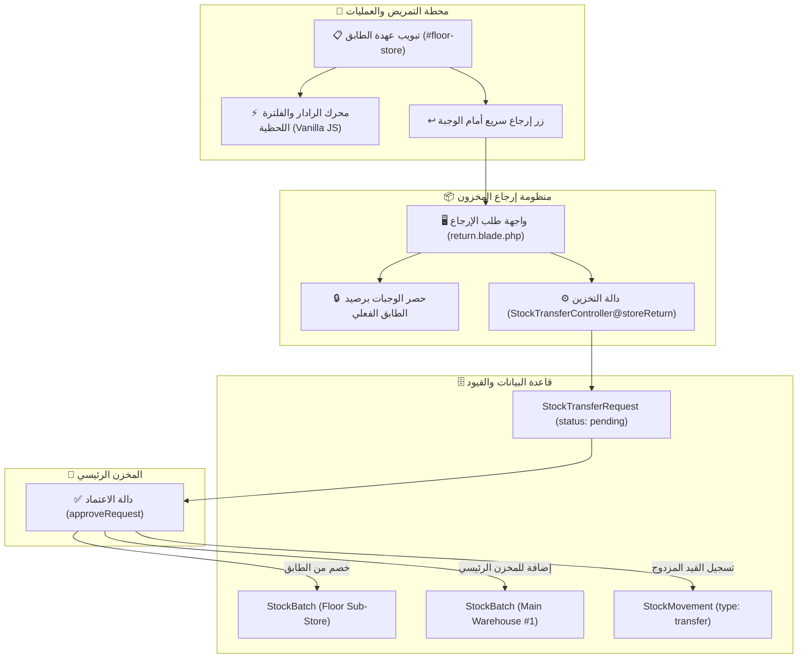

# الخطة التقنية والمعمارية للميزة: رادار عهدة الطابق ودورة الإرجاع للمخزن الرئيسي
## Technical Architecture & Implementation Plan: Feature `001-floor-store-and-returns`

- **معرف الميزة (Feature ID):** `001-floor-store-and-returns`
- **الحالة (Status):** `قيد التنفيذ (In Progress)`
- **التاريخ (Date):** 2026-11-03

---

## 1. المعمارية التقنية ومكونات النظام (System Architecture)

---

## 2. خريطة الملفات والأكواد المستهدفة (Target Files & Changes)

### 1. واجهة محطة التمريض (`resources/views/surgery-stations/nursing/index.blade.php`):
- **الموقع:** داخل الحاوية `
`.
- **التعديلات:**
  1. إضافة ترويسة تفاعلية تضم:
     - شريط بحث فوري: `<input id="floorStockSearchInput" ...>` مع أيقونة بحث وزر مسح سريع.
     - شارات تصفية سريعة (Filter Pills): `[الكل]`، `[💊 أدوية]`، `[🩹 مستلزمات]`، `[⚠️ شارف على النفاد]`، `[⏳ قريبة الانتهاء]`.
     - زر إرجاع بارز في الترويسة: `[ ↩️ إرجاع مواد للمخزن الرئيسي ]`.
  2. تحديث جدول المواد:
     - تضمين `data-category`, `data-name`, `data-barcode`, `data-low-stock`, `data-expiring-soon` على كل صف `<tr>`.
     - إضافة زر إجرائي في العمود الأخير: `[ ↩️ إرجاع ]` يمرر `batch_id` و `from_location_id`.
  3. كود JavaScript خفيف وفائق السرعة في نهاية الصفحة يقوم بالفلترة اللحظية (Zero latency).

### 2. كنترولر التحويلات والمخزن (`app/Http/Controllers/StockTransferController.php`):
- **الدوال المعنية:**
  1. `createReturn(Request $request)`:
     - استنتاج المخزن المصدر من حساب المستخدم إذا كان ممرضاً/أمين عهدة (`$user->location_id`) أو من المعامل `from_location_id`.
     - جلب الوجبات المتوفرة حصراً في هذا المخزن: `StockBatch::where('location_id', $fromLocationId)->where('current_qty', '>', 0)->with('product')->get()`.
     - جلب الوجبة المحددة مسبقاً إذا تم تمرير `batch_id`.
     - تمرير قائمة أسباب الإرجاع المعتمدة.
  2. `storeReturn(Request $request)`:
     - التحقق الأمني من صلاحية المستخدم على المخزن المصدر.
     - دعم إرجاع مادة واحدة أو مصفوفة مواد (`items.*.product_id`, `items.*.batch_id`, `items.*.qty`, `items.*.reason`).
     - التحقق الصارم من أن الكمية المطلوبة $\le$ رصيد الوجبة المتاح في الطابق.
     - إنشاء سجل `StockTransferRequest` بالحالة `pending`.
  3. `approveRequest`:
     - الحفاظ على منطق النقل الذري الحالي مع تعزيز التوثيق والرسائل لعمليات الإرجاع.

### 3. واجهة طلب الإرجاع (`resources/views/stock-transfers/return.blade.php`):
- إعادة تصميم الواجهة بالكامل:
  - قفل المخزن المصدر تلقائياً وعرض اسم الطابق بشارة واضحة.
  - تحديد المخزن الرئيسي كوجهة استلام افتراضية.
  - جدول تفاعلي لاختيار المواد والكميات والأسباب مع دعم إضافة/حذف أسطر ديناميكياً.
  - عرض الرصيد المتاح لحظياً لكل مادة يتم اختيارها لمنع إدخال كميات غير متوفرة.

### 4. حزمة الاختبارات الآلية (`tests/Feature/FloorStockReturnWorkflowTest.php`):
- اختبار شامل يغطي سيناريوهات التحقق الوظيفي والأمني.

---

## 3. التدابير الأمنية وسلامة البيانات (Data Integrity & Guardrails)
1. **قفل المخزن المصدر (Source Location Scoping):** الممرض لا يمكنه تقديم طلب إرجاع نيابة عن طابق آخر.
2. **منع الإرجاع الوهمي:** لا يمكن اختيار مادة رصيدها 0 في الطابق.
3. **التحقق من الرصيد لحظة التقديم ولحظة الاعتماد:** فحص مزدوج للرصيد عبر `lockForUpdate`.
4. **دعم بيئة Hostinger المتعددة:** عدم استخدام مسارات صلبة، واستخدام `{{ url('/') }}` و `{{ route(...) }}`.

