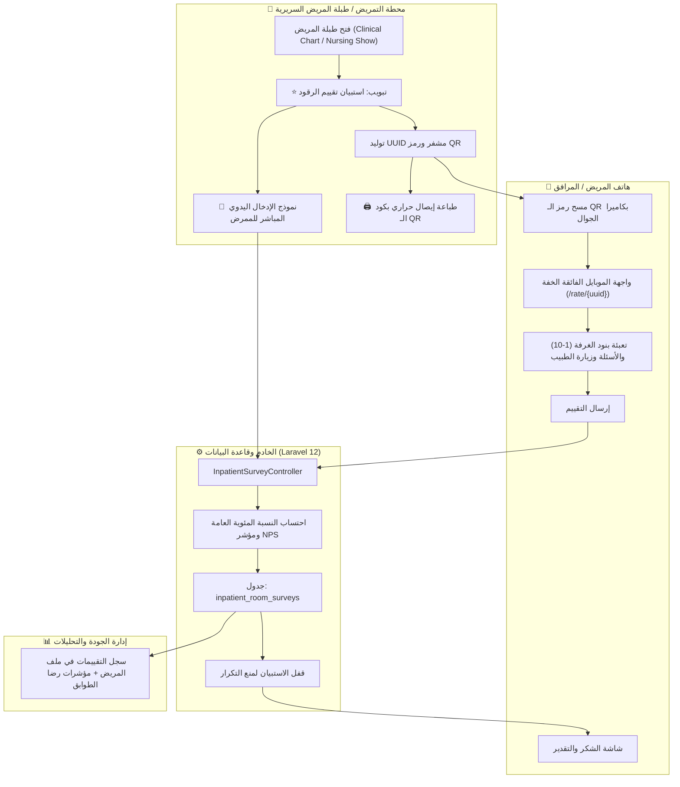

# الخطة التقنية والمعمارية: منظومة استبيان وتقييم غرفة الرقود
## Technical Architecture & Implementation Plan: Feature `002-inpatient-room-survey`

- **معرف الميزة:** `002-inpatient-room-survey`
- **الحالة:** `جاهز للتنفيذ (Ready for Execution)`
- **التاريخ:** 2026-11-04

---

## 1. مخطط تدفق البيانات والعمليات (System Architecture Flow)

---

## 2. خريطة الجداول والملفات المستهدفة (Database & Code Map)

### 1. طبقة قاعدة البيانات والنماذج (Database & Model):
- **المايجريشن:** `database/migrations/2026_11_04_000001_create_inpatient_room_surveys_table.php`
  - القيود: ربط بـ `surgeries`, `patients`, `doctors`, `rooms`, `locations`, `users`.
  - تخزين البنود الـ 10 كمقاييس عددية (1-5) والأسئلة المفتوحة والمقترحات والـ NPS.
  - حقل `uuid` فريد ومفهرس للوصول السريع بدون مصادقة.
- **الموديل:** `app/Models/InpatientRoomSurvey.php`
  - دوال الربط (Eloquent Relations):
    * `surgery()`, `patient()`, `doctor()`, `room()`, `location()`, `submittedBy()`.
  - تحويلات البيانات (Casts):
    * `top_three_improvements` => `'array'`
    * `completed_at` => `'datetime'`
    * `survey_date` => `'date'`
  - دوال مساعدة لحساب متوسط الرضا وتقييم النجوم.

### 2. طبقة الكنترولر والمسارات (Controllers & Routes):
- **الكنترولر:** `app/Http/Controllers/InpatientSurveyController.php`
  - `showByUuid(string $uuid)`: عرض واجهة الموبايل للمريض إذا كان الاستبيان `pending`.
  - `submitByUuid(Request $request, string $uuid)`: استقبال إجابات هاتف المريض، احتساب النتيجة، وتحديث الحالة إلى `completed`.
  - `storeManual(Request $request, Surgery $surgery)`: حفظ التقييم اليدوي من محطة التمريض.
  - `printQr(Surgery $surgery)`: عرض قالب الإيصال الحراري بالـ QR للطباعة المباشرة.
- **المسارات في `routes/web.php`:**
  - مسارات عامة (Public بدون تسجيل دخول):
    * `GET /rate/{uuid}` -> `inpatient-surveys.public.show`
    * `POST /rate/{uuid}` -> `inpatient-surveys.public.submit`
  - مسارات تمريضية مصرحة:
    * `POST /surgeries/{surgery}/inpatient-survey` -> `inpatient-surveys.manual.store`
    * `GET /surgeries/{surgery}/inpatient-survey/print-qr` -> `inpatient-surveys.print-qr`

### 3. واجهات العرض (Views):
- `resources/views/surveys/inpatient-public.blade.php`: واجهة هاتف متجاوبة، عربية أنيقة مع رموز تفاعلية سلسة.
- `resources/views/surveys/thank-you.blade.php`: شاشة شكر وتأكيد بعد إرسال التقييم.
- `resources/views/surveys/print-qr.blade.php`: وصل حراري نظيف (80mm) يحتوي شعار المستشفى ورمز الـ QR وبيانات المريض والغرفة.
- تحديث طبلة المريض بمحطة التمريض والعمليات:
  - `resources/views/surgery-stations/clinical/show.blade.php` و `resources/views/surgery-stations/nursing/show.blade.php` لإضافة التبويب الجديد.

---

## 3. التدابير الأمنية والوقائية (Security & Guardrails)
1. **رمز الوصول المشفر (Cryptographic UUID):** استخدام رموز عشوائية آمنة `Str::uuid()` تمنع التخمين أو تصفح استبيانات المرضى الآخرين.
2. **منع التكرار (Single Submission Lock):** بمجرد إرسال الاستبيان، يُقفل الرابط برمجياً وأي محاولة وصول لاحقة تعرض رسالة شكر وتمنع إعادة الكتابة.
3. **حماية التوافق مع البيئات المتعددة:** توليد روابط الـ QR دائماً بدوال لارافيل `{{ url('/rate/' . $survey->uuid) }}` لدعم الهوستنجر والمحلي بسلاسة.

